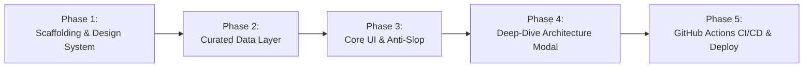

# Roadmap Pengembangan Portofolio: `ihkaru.github.io`

> **Visi Proyek**: Membangun portofolio web statis personal berkinerja tinggi yang memamerkan 7 proyek rekayasa perangkat lunak utama dari `ihkaru` dan `ipds6104`, bebas dari klaim palsu dan template AI generik (*anti-slop*), dan ter-deploy secara otomatis ke GitHub Pages (`https://ihkaru.github.io/`).

---

## 🗺️ Arsitektur Roadmap & Fase Implementasi

Roadmap ini terbagi ke dalam **5 Fase Bertahap**:

---

## 📌 Rincian Fase & Tautan Dokumen Detail

### [Phase 1: Project Scaffolding & Anti-Slop Design System](file:///root/projects/ihkaru.github.io/docs/phases/01_project_scaffolding_and_design_system.md)
- Inisialisasi stack Svelte 5 (Runes) + Vite 7 dengan package manager Bun.
- Setup Tailwind CSS v4, font Google (Space Grotesk, Lora, Space Mono).
- Kontrak desain `DESIGN.md` (Dials `ENERGY 2 / RHYTHM 2 / MOTION 2`, palet matte monochrome, zero-slop rules).

### [Phase 2: Curated Data Layer & System Architecture Models](file:///root/phases/02_curated_data_layer_and_architecture_models.md)
- Schema TypeScript ketat (`src/types/portfolio.ts`) untuk proyek, metrik riil, dan alur arsitektur.
- Dataset kurasi lengkap 7 proyek utama (`src/data/projects.ts`):
  1. **Aina (あいな)** *(Paling Utama / Flagship)* — WhatsApp Agentic AI in Pure Rust.
  2. **Cerdas** — Open-Source AppSheet Alternative (Laravel Octane + Vue 3 + SQLite PWA).
  3. **Lumis** — Ultra-Lightweight Enterprise AI Chat Platform in Rust & Svelte 5 (<25MB RAM).
  4. **Propylon Gateway** — Zero-Trust MCP Control Plane in Pure Rust (Zero-Unsafe).
  5. **SSO BPS Mempawah (rIDM)** — SAML 2.0 & OIDC Central IdP in Rust (40-60MB RAM).
  6. **FlashLearn** — Hexagonal Active-Recall Educational Platform (Bun + Elysia + Svelte 5).
  7. **Dokter-V (Sikendis)** — Financial & Assignment Governance with AI SBM Engine.

### [Phase 3: Core UI Components & Anti-Slop Implementation](file:///root/projects/ihkaru.github.io/docs/phases/03_ui_components_and_antislop_contract.md)
- Navbar dengan indikator status ketersediaan live (`emerald-400`) dan pengalih bahasa tenang (`EN / ID`).
- Hero section dengan positioning jelas (*Systems, AI Agents, & High-Performance Engineering*).
- Spotlight Hero Card khusus untuk **Aina** dengan terminal telemetri WhatsApp live (<5ms FTS5, quota pool status).
- 2-Column Responsive Project Grid untuk proyek 2–7 dengan filter domain interaktif.
- Footer terstruktur dengan timestamp build dan lisensi MIT.

### [Phase 4: Architecture Deep-Dive Drawer / Modal & Interactive Visualizer](file:///root/projects/ihkaru.github.io/docs/phases/04_deep_dive_modal_and_interactive_architecture.md)
- Dialog modal detail arsitektur interaktif saat kartu proyek diklik atau diakses via URL hash (`#project-aina`, `#project-cerdas`, dsb.).
- Visualisasi alur data sistem per langkah (*system sequence flow*).
- Kepatuhan aksesibilitas penuh (keyboard navigation, Escape to close, focus trap, touch targets $\ge 44\text{px}$).

### [Phase 5: GitHub Actions CI/CD & Deployment to `ihkaru.github.io`](file:///root/projects/ihkaru.github.io/docs/phases/05_github_actions_ci_cd_and_deployment.md)
- Konfigurasi workflow GitHub Actions `.github/workflows/deploy.yml` berbasis Bun.
- Otomasi pembuatan repository dan sinkronisasi ke remote GitHub `ihkaru/ihkaru.github.io` via `gh` CLI.
- Verifikasi hasil deployment live di `https://ihkaru.github.io/`.
