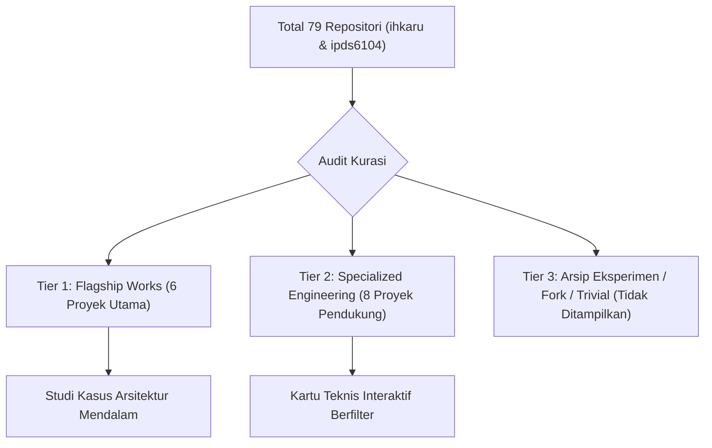

# Kurasi & Audit Repositori: `ihkaru` & `ipds6104`

> **Tujuan Riset**: Melakukan kurasi mendalam terhadap seluruh repositori publik dari akun GitHub `ihkaru` dan organisasi `ipds6104`, memilah proyek-proyek *flagship* berkekuatan teknis tinggi, dan menyusun strategi showcase tanpa klaim kosong (*zero slop*).

---

## 1. Inventarisasi & Klasifikasi Repositori

Total repositori publik yang dianalisis:
- **`ihkaru`**: 60 repositori
- **`ipds6104`**: 19 repositori

Berdasarkan tingkat kompleksitas rekayasa perangkat lunak, kebaruan (*originality*), dan keandalan sistem, portofolio harus memisahkan repositori ke dalam 3 tier:

---

## 2. Tier 1: Flagship Projects (Showcase Utama & Deep-Dive)

Proyek di tier ini memiliki arsitektur orisinil, efisiensi memori tinggi, dan memecahkan masalah nyata pada level sistem:

### 1. **Lumis** (`ihkaru/lumis` & `ipds6104/lumis-enterprise-stack`)
- **Headline**: Ultra-Lightweight Enterprise AI Chat Interface & Platform in Pure Rust & Svelte 5.
- **Kategori**: Systems / AI Infrastructure / Full-Stack
- **Tech Stack**: Rust (Axum, Tokio, SQLx), Svelte 5 (Runes), SQLite / LibSQL / PostgreSQL, Docker / Coolify.
- **Nilai Teknis Kunci**:
  - Footprint memori super irit (<25 MB RAM saat idle vs ~400 MB pada platform berbasis Python/Node.js).
  - Pluggable Multi-Database Architecture (SQLite, PostgreSQL).
  - Zero-mock enterprise gateway dengan dynamic tool discovery & execution.
  - Streaming SSE berkecepatan tinggi tanpa buffering overhead.

### 2. **Propylon Gateway** (`ihkaru/propylon-gateway`)
- **Headline**: Enterprise-Ready Model Context Protocol (MCP) & Skill Gateway in Pure Rust.
- **Kategori**: Systems / AI Security / Cloud
- **Tech Stack**: Rust (Async Tokio), MCP Specification, Zero-Trust IAM, Real-Time DLP.
- **Nilai Teknis Kunci**:
  - Tamper-evident SIEM audit trails dan monitoring konsumsi token/biaya AI (*FinOps budget freezes*).
  - Inspeksi data egress secara in-situ untuk mencegah kebocoran secret atau PII ke LLM pihak ketiga.
  - Runtime sub-millisecond dispatching ke puluhan container MCP backend.

### 3. **Cerdas** (`ihkaru/cerdas`)
- **Headline**: Open-Source, Self-Hosted Offline-First Mobile Data Collection Engine.
- **Kategori**: Enterprise Web & Mobile Platform
- **Tech Stack**: Vue.js, Laravel / PHP, SQLite PWA, Docker.
- **Nilai Teknis Kunci**:
  - Alternatif open-source untuk Google AppSheet / KoboToolbox / ODK.
  - Offline-first bidirectional sync engine dengan dynamic form schema definition.
  - Mendukung ribuan enumerator survei lapangan tanpa biaya lisensi per user.

### 4. **Aina Assistant** (`ipds6104/aina`)
- **Headline**: Self-Hosted Agentic AI Assistant for WhatsApp Powered by Antigravity CLI in Rust.
- **Kategori**: Autonomous Agents / Messaging Engine
- **Tech Stack**: Rust, WhatsApp Web Protocol (Whatsmeow Bridge), AGY CLI Engine.
- **Nilai Teknis Kunci**:
  - Mengintegrasikan WhatsApp dengan autonomous agentic AI loop untuk automasi data organisasi.
  - Persistent session management dengan anti-ban guard dan auto-healing connection.

### 5. **Economy Simulation Engine** (`ihkaru/economy` & `economy-aggregator`)
- **Headline**: Deterministic Agent-Based Modeling (ABM) Economic Simulation Engine in Rust.
- **Kategori**: High-Performance Computing / Data Science
- **Tech Stack**: Rust, Rayon (Data Parallelism), Apache Parquet, Complex Adaptive Systems (CAS).
- **Nilai Teknis Kunci**:
  - Simulasi jutaan agen ekonomi secara deterministik berbasis Austrian Capital Theory & Biological Maturity.
  - Ekspor data analitik langsung ke format columnar Parquet terkompresi dengan efisiensi $O(1)$ stream disk writing.

### 6. **rIDM (Rust Identity & Access Management)** (`ipds6104/auth`)
- **Headline**: Ultra-Fast Enterprise SSO, SAML 2.0 & OIDC Identity Platform in Rust.
- **Kategori**: Identity & Cybersecurity
- **Tech Stack**: Rust, SAML 2.0, OpenID Connect (OIDC), Cryptographic Signature Verification.
- **Nilai Teknis Kunci**:
  - Solusi IAM berkinerja tinggi yang menggantikan keycloak untuk kebutuhan single-sign-on instansi dengan resource footprint minimal.
  - Integrasi SSO multitenant dan sinkronisasi kepegawaian internal.

---

## 3. Tier 2: Specialized Engineering (Proyek Pendukung Pilihan)

Proyek-proyek ini memperkuat kedalaman teknis dan versatilitas di bidang backend, data streaming, dan web modern:

| No | Repositori | Pemilik | Tech Stack | Fokus & Keunikan Rekayasa |
| :---: | :--- | :---: | :--- | :--- |
| 1 | **flashlearn** | `ihkaru` / `ipds6104` | Bun, Svelte 5, Framework7 | Learning platform heksagonal offline-ready dengan material, adaptif kuis, flashcards, dan Google OAuth. |
| 2 | **tradingview-streamer-rs** | `ihkaru` | Rust, Async WebSockets | Async streamer WebSocket TradingView berkinerja tinggi dengan dukungan Extended Trading Hours (ETH). |
| 3 | **human-gradient-descent** | `ihkaru` | TypeScript, Agent Skills | Standar kurikulum adaptif berbasis prediksi forward-pass dan optimasi backward-pass pada skala ensiklopedia. |
| 4 | **micro-node** | `ipds6104` | C, QuickJS / V8, libuv | Membangun runtime Node.js dari nol: host C + Javascript engine + libuv event loop. |
| 5 | **mediavault** | `ihkaru` | Rust, Axum, Meilisearch | Universal media vault dengan resumable TUS chunk uploads, thumbnailing SIMD WebP, dan sub-50ms search. |
| 6 | **epistex** | `ihkaru` | Python, Git, Infisical | Enterprise git-based knowledge base starter kit dengan hermetic execution dan secret injection. |
| 7 | **whatsmeow-coolify-bot** | `ipds6104` | Go, PostgreSQL, Traefik | REST API WhatsApp daemon dengan durable session, anti-ban heuristic, dan auto-deploy Coolify. |
| 8 | **GardaData** | `ipds6104` | TypeScript | Platform terpadu penjaminan dan monitoring integritas data statistik. |

---

## 4. Tier 3: Repositori yang Dikecualikan dari Tampilan

Untuk menjaga reputasi profesional dan standar anti-slop, repositori berikut **tidak ditampilkan**:
1. **Fork murni tanpa modifikasi signifikan**: `exploitgym`, `librechat` (upstream mirrors).
2. **Repositori scratch / eksperimen awal**: `test`, `ihkaru1`, `tpa`, `tpa-project-2`, `splade-app`, `quasarr-app-test`.
3. **Repositori kosong atau tugas kuliah lama**: `CSTJadwalKuliah`, `utssvm`, `visdat`, `cdc` (kecuali dikurasi sebagai arsip pembelajaran terpisah).

---

## 5. Strategi Penyajian Data Portofolio (Anti-Slop Content Guidelines)

Agar portofolio terhindar dari kesan *"template AI generic"*, data proyek akan disajikan dengan prinsip berikut:
- **Arsitektur Nyata (Real Architecture Diagrams)**: Setiap proyek Tier 1 dilengkapi diagram arsitektur interaktif / SVG sederhana (misal alur Axum -> SQLite -> Svelte 5 SSE).
- **Metrik Riil**: Tampilkan metrik konkret yang dapat dibuktikan dari repo (contoh: *"<25MB RAM Idle"*, *"Pure Rust Async"*, *"Zero Copy Streaming"*, *"Apache Parquet Output"*), bukan klaim abstrak seperti *"solusi revolusioner"*.
- **Direct Source Links**: Setiap kartu proyek memiliki tautan langsung ke repository GitHub, release tag, atau live deployment yang aktif.
- **Filter Berdasarkan Domain**:
  - `All`
  - `Systems & Rust`
  - `AI & Autonomous Agents`
  - `Enterprise Platforms`
  - `Data & High-Performance`
