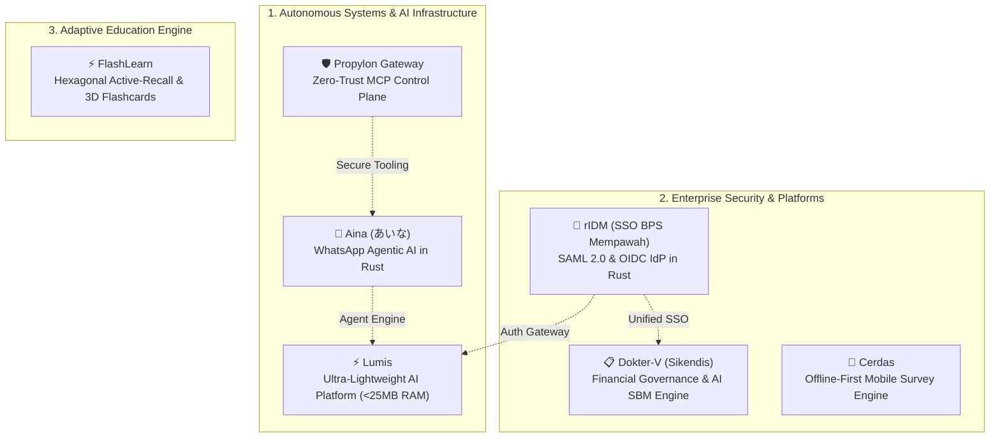
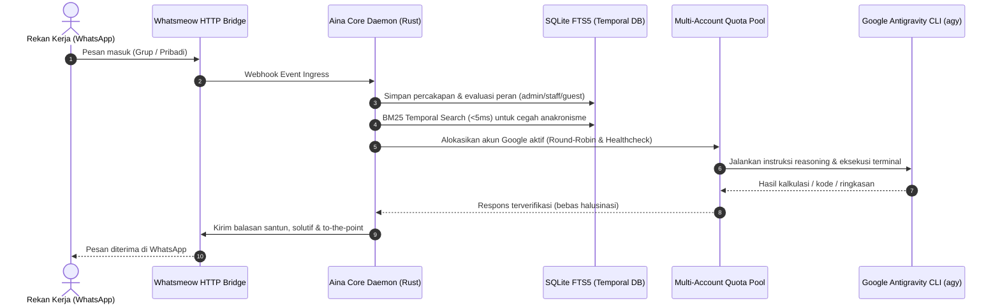

# Eksplorasi Mendalam 7 Proyek Portofolio Utama

> **Koleksi Pilihan**: 7 Proyek Unggulan Terkurasi dari `ihkaru` dan `ipds6104`.  
> **Urutan Prioritas**: **Aina** *(Flagship #1)* $\rightarrow$ **Cerdas** $\rightarrow$ **Lumis** $\rightarrow$ **Propylon Gateway** $\rightarrow$ **SSO BPS Mempawah (rIDM)** $\rightarrow$ **FlashLearn** $\rightarrow$ **Dokter-V (Sikendis)**.

---

## Ringkasan Eksekutif & Matriks Perbandingan

| No | Proyek | Repositori GitHub | Tech Stack Utama | Fokus Utama Rekayasa |
| :---: | :--- | :--- | :--- | :--- |
| **1** | **Aina (あいな)** *(Utama)* | [`ipds6104/aina`](https://github.com/ipds6104/aina) | Rust 2024, Whatsmeow, Google AGY CLI, SQLite FTS5 | Asisten AI rekan kerja WhatsApp mandiri dengan Multi-Account Quota Pool & DAC. |
| **2** | **Cerdas** | [`ihkaru/cerdas`](https://github.com/ihkaru/cerdas) | Laravel 12 Octane, Vue 3, Framework7, Capacitor | Alternatif open-source AppSheet untuk pendataan survei mobile offline-first tanpa batas user. |
| **3** | **Lumis** | [`ihkaru/lumis`](https://github.com/ihkaru/lumis) | Rust 1.93 (Axum 0.8), Svelte 5 Runes, SQLite/Postgres | AI chat interface enterprise berkinerja tinggi, RAM <25MB, dan Generative UI (OpenUI). |
| **4** | **Propylon Gateway** | [`ihkaru/propylon-gateway`](https://github.com/ihkaru/propylon-gateway) | Rust 2024 (Zero-Unsafe), MCP Protocol, DuckDB/Polars | Control plane reverse proxy MCP enterprise dengan proteksi DLP in-situ dan zero-knowledge credentials. |
| **5** | **SSO BPS Mempawah (rIDM)** | [`ipds6104/auth`](https://github.com/ipds6104/auth) | Rust, SAML 2.0, OIDC, Argon2id, SQLite | Central Identity Provider (IdP) super ringan (40–60MB RAM) pengganti Keycloak dengan auto-rehash password. |
| **6** | **FlashLearn** | [`ihkaru/flashlearn`](https://github.com/ihkaru/flashlearn) | Bun, Elysia.js, PostgreSQL (Drizzle), Svelte 5, Framework7 | Platform belajar active-recall berarsitektur heksagonal dengan materi, kuis, dan 3D flashcards instan. |
| **7** | **Dokter-V (Sikendis)** | [`ihkaru/sipedas`](https://github.com/ihkaru/sipedas) | PHP 8.4 FrankenPHP Octane, Redis, MySQL, arc42 | Platform tata kelola keuangan dinas, validasi batas honor SBM 2026, dan Laporan Perjalanan Dinas AI. |

---

## 1. 🌸 Aina (あいな) — Flagship Utama

> **"Self-Hosted Agentic AI Co-Worker in Pure Rust via WhatsApp"**

### Masalah yang Dipecahkan
Bot percakapan WhatsApp umumnya hanya berupa rule-based script kaku atau pembungkus API OpenAI sederhana yang boros token, mudah terkena blokir (*rate-limit*), tidak memahami konteks waktu, dan rentan membocorkan dokumen kantor antar-pegawai.

### Solusi & Arsitektur
Aina dibangun dengan arsitektur heksagonal dalam **Pure Rust 2024**, menghubungkan protokol WhatsApp Web (via daemon Whatsmeow) secara langsung dengan mesin agentik **Google Antigravity CLI (`agy`)**.

### Inovasi Rekayasa Kunci
1. **Multi-Account Quota Pool**: Otomatis merotasi 5–11 akun Google secara *round-robin* dan auto-failover ketika kuota akun harian habis (mengeliminasi error 429).
2. **File & Data Custodianship (DAC)**: Dokumen kerja (PDF, spreadsheet) yang dikirim oleh seorang staf otomatis dikunci di bawah hak milik penitip (*Data Custodian*); pengguna lain tidak dapat meminta isi dokumen tersebut tanpa persetujuan eksplisit.
3. **Instant Temporal Search (<5ms)**: Mesin pencarian riwayat percakapan SQLite FTS5 BM25 terindeks waktu presisi (`--since 7d`, rentang tanggal) untuk mengeliminasi anakronisme informasi.
4. **Dual-WhatsApp Pipeline**: Mendukung nomor bot resmi (`PrimaryBot`) sekaligus akun pribadi pendamping (`UserCompanion` / *Shadow Sensor*) untuk mencerna konteks puluhan grup kantor tanpa perlu menambahkan bot ke grup.
5. **Tabayyun & Tawaqquf Policy**: Secara proaktif menanyakan klarifikasi jika instruksi multitafsir, dan menolak membocorkan data sensitif instansi ke penanya eksternal.

---

## 2. 🧠 Cerdas — Offline-First Mobile Survey Engine

> **"Open-Source Self-Hosted AppSheet Alternative for Complex Field Surveys"**

### Masalah yang Dipecahkan
Platform pengumpulan data komersial seperti AppSheet membebankan biaya lisensi mahal ($10/user/bulan) dan membatasi tier gratis hanya untuk 10 pengguna. Sementara itu, platform open-source lain seperti KoboToolbox memiliki konfigurasi hosting rumit dan kapabilitas offline yang terbatas.

### Solusi & Arsitektur
Monorepo pnpm berskala enterprise yang mengombinasikan backend berkinerja tinggi **Laravel 12 Octane + FrankenPHP**, visual form builder berbasis **Vue 3**, dan aplikasi mobile PWA/Android berbasis **Framework7 + Capacitor + SQLite**.

### Inovasi Rekayasa Kunci
1. **Zero User Limit**: Self-hosted Docker one-click deployment dengan kapasitas ribuan enumerator lapangan tanpa biaya lisensi per user.
2. **JS Expression Engine**: Memungkinkan perancang kuesioner menulis closure JavaScript langsung pada editor visual untuk logika dinamis:
   - `Show If` (visibilitas pertanyaan bersyarat).
   - `Editable If` (kontrol edit data).
   - `Formula` & `Initial Value` (perhitungan nilai otomatis).
   - `Warning` (validasi batas kewajaran data statistik).
3. **True Offline-First Sync**: Klien mobile beroperasi penuh di wilayah tanpa sinyal menggunakan embedded SQLite lokal, lalu melakukan sinkronisasi dua arah (*bi-directional sync*) dengan resolusi konflik saat jaringan kembali tersedia.
4. **Offline Spatial Preview**: Integrasi MapLibre GL untuk visualisasi poligon dan titik koordinat GPS enumerator tanpa membutuhkan koneksi internet aktif.

---

## 3. ⚡ Lumis — Ultra-Lightweight Enterprise AI Platform

> **"High-Assurance AI Chat Interface in Pure Rust & Svelte 5 (<25MB RAM)"**

### Masalah yang Dipecahkan
Web UI LLM populer (seperti LibreChat, Open WebUI) memakan memori server sangat besar (300MB – 1.5GB RAM per instance) karena bergantung pada ekosistem Node.js/Python yang berat, sulit di-embed ke aplikasi lain, dan rentan terhadap ketergantungan database tunggal.

### Solusi & Arsitektur
Implementasi *clean-room* dalam **Rust 1.93 (Axum 0.8)** dipadukan dengan **Svelte 5 Runes** untuk frontend:
- **Footprint Memori**: **<25MB RAM saat idle** (efisiensi lebih dari 10x lipat dibanding alternatif Node.js).
- **Pluggable Multi-Database**: Mendukung SQLite WAL lokal ultra-ringan hingga PostgreSQL pool enterprise tanpa perlu mengubah kode aplikasi.
- **SIMD Guardrails**: Pemindaian kata terlarang dan data rahasia (*Data Loss Prevention*) berkecepatan $O(N+Z)$ menggunakan algoritma Aho-Corasick berakselerasi CPU SIMD.
- **Generative UI (OpenUI Reactive Engine)**: Parser streaming CommonMark yang mampu merender komponen interaktif (slider, stepper, grafik kalkulator) secara dinamis langsung di dalam gelembung obrolan via sandbox iframe berkecepatan 120Hz GPU.

---

## 4. 🛡️ Propylon Gateway — Zero-Trust MCP Control Plane

> **"Enterprise Reverse Proxy & Dynamic Firewall for Model Context Protocol (MCP)"**

### Masalah yang Dipecahkan
Gateway MCP generasi pertama beroperasi sebagai wrapper proses tunggal yang rapuh: state terkunci di memori, tidak memiliki proteksi kebocoran data (*DLP*), rawan crash saat konfigurasi diubah, dan mengekspos API key mentah ke model LLM.

### Solusi & Arsitektur
Control plane reverse proxy dalam **Pure Rust 2024** (`#![deny(unsafe_code)]`, 189 tests 100% pass) dengan prinsip *Zero-Trust*:
1. **Dual-Stack Adaptive MCP Negotiation**: Mendukung spesifikasi modern **MCP `2026-07-28`** (stateless HTTP headers, anti-desync validation, cache hints `ttlMs`) dan backward compatibility ke versi legacy `2024-11-05`.
2. **Zero-Knowledge Credential Brokerage**: Kredensial sensitif (OAuth tokens, API keys) disuntikkan secara dinamis di level gateway loopback in-memory. Model AI tidak pernah melihat atau menyimpan API key mentah.
3. **In-Situ Analytical Enclave**: Eksekusi analitik server-side menggunakan **DuckDB / Polars** langsung pada dataset besar (100MB+ Parquet/ZIP) di memori gateway, hanya mengembalikan ringkasan teragregasi (<1KB) ke LLM (**reduksi data egress >99.9%**).
4. **Zero-Downtime Hot-Reload**: Penambahan tools atau perubahan tier kebijakan (`dev`/`hybrid`/`strict`) diperbarui secara atomik via `RwLock`/RCU tanpa memutus stream agen AI yang sedang aktif.
5. **FinOps & Killswitch**: Pembekuan kuota otomatis (*budget freeze*) saat terdeteksi loop tak terbatas pada agen otonom.

---

## 5. 🦀 SSO BPS Mempawah (rIDM Platform)

> **"Ultra-Fast Central Identity Provider in Rust (SAML 2.0 & OIDC SSO)"**

### Masalah yang Dipecahkan
Server SSO tradisional berbasis Java (seperti Keycloak) membutuhkan alokasi memori besar (1GB – 2GB RAM), waktu startup lambat, dan konfigurasi yang rumit untuk skala satker daerah.

### Solusi & Arsitektur
Central Identity Provider (IdP) berbasis **Rust** ([rIDM](https://github.com/ZerosAndOnesLLC/rIDM)) yang beroperasi di `https://auth.dvlpid.my.id/`:
- **Footprint Memori**: Hanya **~40–60MB RAM** (penghematan sumber daya server drastis).
- **Protokol Standar Ganda**: Mendukung native **SAML 2.0** (untuk aplikasi legacy kementerian/instansi) dan **OpenID Connect / OIDC** (untuk aplikasi modern Svelte, Vue, Laravel, Go, Rust).
- **Tenant Khusus**: Tenant `bps` untuk mengelola seluruh ekosistem layanan digital BPS Kabupaten Mempawah.
- **Transisi Password Mulus**: Mengimpor 37 akun pengguna dan 36 pegawai dari database eksisting dengan preservasi hash `bcrypt`, kemudian otomatis meng-upgrade (*rehash*) ke standar kriptografi modern **`argon2id`** saat user pertama kali login.
- **Atribut Profil Kustom**: Mendukung integrasi NIP 18 digit dan NIP 9 digit BPS langsung pada ID Token & klaim UserInfo.

---

## 6. ⚡ FlashLearn — Active-Recall Learning Platform

> **"Hexagonal Active-Recall Engine: Theory, Quizzes & Instant 3D Flashcards"**

### Masalah yang Dipecahkan
Aplikasi edukasi sering memisahkan materi bacaan dari evaluasi kuis, atau menyajikan flashcard hafalan statis yang membosankan tanpa integrasi alur kognitif yang mulus.

### Solusi & Arsitektur
Monorepo modern berkinerja tinggi:
- **Backend**: Bun + TypeScript + Elysia.js + PostgreSQL (Drizzle ORM) dengan **Hexagonal Architecture (Ports & Adapters)** murni (Domain layer independen dari database dan HTTP framework).
- **Frontend**: Svelte 5 (Runes) + Framework7 v9 + Vite.
- **Instant 3D Flip Flashcards**: Begitu pengguna menyelesaikan kuis, satu ketukan langsung mengonversi seluruh butir soal dan miskonsepsi menjadi tumpukan kartu fisik 3D interaktif untuk active recall (*Again, Hard, Good, Easy*).
- **Triple Content Modes**: Mendukung mode "Materi Saja", "Quiz Saja", dan "Materi & Quiz Terangkai".
- **Developer Scoped API Keys**: Generator API key (`fl_live_...`) berbasis hak akses (RBAC) untuk automasi integrasi konten kurikulum via REST API & Scalar OpenAPI 3.1.

---

## 7. 📋 Dokter-V (Sikendis) — Financial & Assignment Governance

> **"Digitalisasi dan Otomatisasi Kelola Transaksi Keuangan Real-Time BPS"**

### Masalah yang Dipecahkan
Pengelolaan penugasan lapangan dan pencairan honor mitra statistik di satker daerah rawan bentrok jadwal penugasan (*double booking*), risiko pelanggaran batas kumulatif honor bulanan Standar Biaya Masukan (SBM Kemenkeu), dan lamanya penyusunan laporan perjalanan dinas (LPD).

### Solusi & Arsitektur
Aplikasi enterprise produksi aktif di `https://admin.dvlpid.my.id/` (codename repo: `ihkaru/sipedas`):
- **Runtime Backend**: **PHP 8.4 FrankenPHP Octane** + MySQL (`sikendis`) + Redis Cache & Queue.
- **Dokumentasi Berstandar arc42**: Memiliki dokumentasi arsitektur enterprise lengkap dalam 12 seksi modular (analisis konteks, constraint, runtime view, quality scenarios).
- **Anti-Schedule Collision Engine**: Otomatis mendeteksi dan mencegah penugasan ganda pegawai di tanggal pelaksanaan yang sama.
- **Kepatuhan SBM 2026**: Validasi ketat batas pagu honor mitra bulanan sesuai regulasi Standar Biaya Masukan Menteri Keuangan.
- **Konsolidasi Kontrak Cerdas**: Otomasi penyatuan SPK dan BAST untuk mitra yang mengikuti beberapa survei dalam bulan yang sama.
- **LPD AI (Laporan Perjalanan Dinas AI)**: Mengubah catatan singkat dan foto dokumentasi lapangan menjadi draft laporan dinas formal terstruktur sesuai tata bahasa baku pemerintah (PUEBI).
- **Integrasi Notifikasi & Approval WhatsApp**: Terkoneksi dengan daemon Aina/Whatsmeow untuk persetujuan cepat pimpinan (KPA/PPK/PPSPM) langsung dari ponsel.

---

## Strategi Tampilan Visual Portofolio (Anti-Slop Implementation)

Untuk menampilkan ke-7 proyek ini di `ihkaru.github.io`:

1. **Tata Letak Berbasis Hierarki Keputusan (Decision-Driven Layout)**:
   - **Hero Section**: Memperkenalkan persona Anda sebagai *Systems & Full-Stack Engineer* (Rust, Svelte, Enterprise Web) dengan tone tenang, percaya diri, dan minim basa-basi.
   - **Primary Spotlight**: Kartu interaktif berukuran besar untuk **Aina**, menampilkan cuplikan terminal/chat WhatsApp, status arsitektur multi-akun, dan metrik latensi FTS5 (<5ms).
   - **Tier 1 Showcase (Proyek 2–7)**: Grid kartu 2-kolom yang seimbang, masing-masing menonjolkan:
     - 1 Tagline lugas.
     - 3 Poin inovasi rekayasa konkret.
     - Baris teknologi (*Rust*, *Svelte 5*, *FrankenPHP*, *SQLite*, dsb.).
     - Tautan langsung ke GitHub dan live production/demo.
2. **Modal / Detail Drawer Interaktif**:
   - Menampilkan diagram alur arsitektur (SVG/Mermaid) dan cuplikan studi kasus mendalam untuk pengunjung yang ingin melihat pembuktian teknis (*evidence-first*).
3. **Filter Sederhana & Cepat**:
   - `All` | `Rust & Systems` | `AI & Autonomous Agents` | `Enterprise Platforms`
