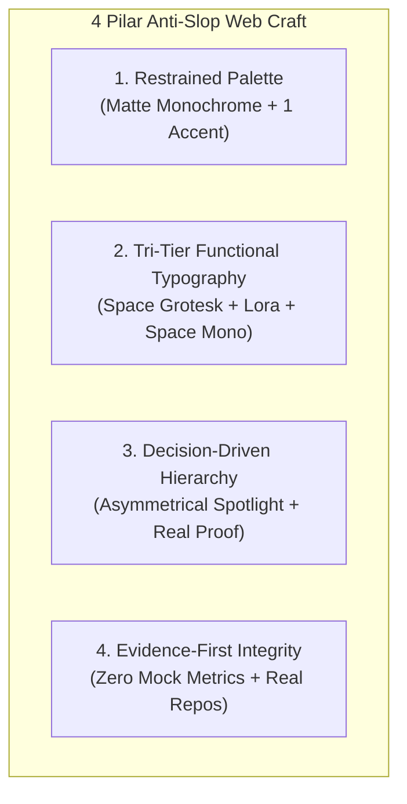

# Prinsip Anti-Slop Web Design & Living UI Architecture

> **Fokus Riset**: Menganalisis fenomena *AI Web Slop* di industri web modern, mengidentifikasi ciri-ciri tampilan yang "terasa dibuat oleh AI", dan merumuskan arsitektur *Living UI* serta *Visual Proof* pada portofolio `ihkaru.github.io`.

---

## 1. Anatomi "AI Web Slop": Mengapa Desain Buatan AI Terasa Mirip?

AI model (Claude, Cursor, v0, ChatGPT) memiliki tendensi statistik yang sama karena dilatih dari dataset template web modern yang seragam (Vercel, Linear, Stripe clones). Tanpa campur tangan panduan manusia (*designer-crafted constraints*), AI akan selalu mengeluarkan pola klise yang sama:

| Ciri AI Slop | Manifestasi Tipikal AI | Mengapa Ini Terasa Murahan / "AI Slop"? |
| :--- | :--- | :--- |
| **1. The Gradient Orb Cliché** | Latar belakang hitam pekat dengan bola gradien ungu-kebiruan (*purple-to-cyan radial glow*) di belakang hero section. | Menjadi penanda instan bahwa situs dibuat tanpa sistem warna identitas (*no brand identity*). |
| **2. Default Font Monotony** | Menggunakan `Inter` atau `Geist` untuk semua elemen teks di semua bobot. | Menghilangkan karakter unik tipografi dan membuat teks terasa seperti template wireframe. |
| **3. The "Three-Card" Grid** | Tiga kartu sejajar dengan ukuran persis sama, ikon abstrak generic (sparkle, lightning), dan tepat 2 baris teks abu-abu. | Tata letak simetris malas yang tidak mencerminkan hierarki keputusan data yang sesungguhnya. |
| **4. Bento-Grid Mosaic Copy-Paste** | Kotak-kotak bento grid dengan terminal window palsu dan grafik statis dummy. | Diterapkan hanya untuk dekorasi (*visual filler*), bukan karena informasi membutuhkan struktur bento. |
| **5. Excessive Glassmorphism** | Efek frosted glass (`backdrop-blur`) di navbar, kartu, modal, dan sidebar secara bersamaan. | Mengaburkan kedalaman antarmuka; jika semua elemen transparan, tidak ada yang menjadi latar depan. |
| **6. Em Dash (—) & Marketing Fluff** | Tombol dan judul penuh tanda em dash dan jargon: *"Everything you need to ship faster"*, *"Unlock seamless possibilities"*, *"delve"*, *"tapestry"*. | Bahasa mesin yang terpoles berlebihan tanpa substansi teknis nyata. |
| **7. Fake Statistics & Ghost Links** | Menampilkan badge *"99.99% Uptime"*, *"10k+ Happy Users"*, atau tombol yang tidak melakukan apa-apa saat diklik. | Fabrikasi klaim palsu yang langsung merusak kredibilitas profesional di mata *engineering leads*. |

---

## 2. Prinsip "De-Slopify": Membuat Desain Terasa Dibuat oleh Manusia

Berdasarkan framework *Anti-Slop Design Guidelines* dan standar *Impeccable Design*:

### 2.1 Enforce Strict Constraints on Color & Textures
- **Hapus gradien ungu-cyan**: Gunakan kanvas matte gelap terfokus (`neutral-950`) dengan kartu solid (`neutral-900`) dan border tipis terukur (`neutral-800`).
- **Dose Cap**: Glassmorphism dibatasi maksimal pada 1 elemen (navbar mengambang dengan `backdrop-blur-md`).
- **Single Status Accent**: Hanya gunakan 1 warna aksen terarah (`emerald-400`) untuk indikator live ketersediaan atau status sistem.

### 2.2 Tri-Tier Functional Typography
Gunakan 3 jenis huruf dengan tugas spesifik:
- **Space Grotesk**: Judul dan penamaan struktur teknis yang tegas dan berwibawa.
- **Lora (Serif Humanis)**: Narasi problem statement dan filosofi rekayasa (memberikan sentuhan humanis dan intelektual).
- **Space Mono**: Metrik komputasi (RAM <25MB, Latency <5ms, commit SHA, dan tag bahasa pemrograman).

### 2.3 Break the Generic Grid (Hero Spotlight vs Supporting Works)
- Hindari membuat semua kartu berukuran sama.
- Proyek nomor 1 (**Aina**) diberikan panggung khusus (*Hero Spotlight Card*) dengan visualisasi panel telemetri WhatsApp live.
- Proyek nomor 2–7 dikelompokkan dalam grid 2-kolom terstruktur dengan filter domain dinamis.

---

## 3. Mengatasi Kelemahan Visual: Arsitektur "Living UI" Previews

Masalah klasik portofolio developer adalah:
> *"Aplikasi backend/sistem hebat, tapi tidak ada visualnya sehingga terlihat seperti halaman artikel biasa."*

Untuk mengatasi hal ini tanpa membuat web menjadi lambat atau bergantung pada screenshot buram, portofolio `ihkaru.github.io` mengimplementasikan **Living UI Components** (`src/components/AppVisualPreview.svelte`):

| Proyek | Wujud Visual "Living UI" yang Diterapkan | Sentuhan Human Craft |
| :--- | :--- | :--- |
| **🌸 Aina** | **WhatsApp Session & Telemetry Bezel**: Simulasi obrolan WhatsApp nyata dengan bubble pesan masuk/keluar, status centang ganda, dan telemetri pencarian FTS5 (<5ms). | Pengunjung langsung paham bahwa Aina adalah rekan kerja AI di WhatsApp, bukan sekadar chatbot web. |
| **🧠 Cerdas** | **Survey Schema & GPS Capture Window**: Visualisasi pohon kuesioner dinamis (`Show If`, `Warning`) dipadukan dengan modul koordinat GPS MapLibre offline. | Membuktikan kapabilitas no-code expression engine dan offline-first. |
| **⚡ Lumis** | **Interactive OpenUI Split-Pane**: Miniatur chat LLM dengan panel samping yang memiliki **slider interaktif Svelte 5 nyata** yang menghitung alokasi RAM secara live. | Interaktif, reaktif, dan membuktikan klaim efisiensi RAM <25MB. |
| **🛡️ Propylon Gateway** | **In-Situ Enclave Pipeline**: Visualisasi alur data reduksi egress: payload 128MB masuk $\rightarrow$ DuckDB Enclave $\rightarrow$ ringkasan 412 Bytes (<0.01% egress) keluar. | Menjelaskan konsep Zero-Trust secara visual tanpa perlu membaca paragraf panjang. |
| **🦀 rIDM SSO** | **Central IdP & Digital Badge**: Mockup portal login `auth.dvlpid.my.id/login/` (tenant `bps`) dengan stempel kriptografi `Argon2id` dan klaim NIP. | Menegaskan peran sebagai Central Identity Provider resmi satker. |
| **⚡ FlashLearn** | **Tactile 3D Flip Flashcard**: Kartu Svelte yang **benar-benar bisa diklik oleh pengunjung untuk berputar 180°** menampilkan pertanyaan $\leftrightarrow$ jawaban kuis dengan tombol grading (*Again, Hard, Good, Easy*). | Memukau pengunjung dengan interaktivitas 3D fisik tanpa dependensi library eksternal yang berat. |
| **📋 Dokter-V (Sikendis)** | **Financial Governance & SBM Engine**: Mockup dashboard surat tugas anti-bentrok jadwal, verifikasi batas honor SBM 2026, dan modul LPD AI. | Membuktikan bahwa aplikasi mematuhi regulasi keuangan negara (PMK SBM). |

---

## 4. Slot Screenshot Asli (`public/projects/`)

Komponen telah dirancang fleksibel:
- Jika di kemudian hari Anda menambahkan file screenshot asli di `public/projects/<slug>.webp` (misal `aina.webp`, `cerdas.webp`, `lumis.webp`), sistem dapat secara otomatis merender gambar resolusi tinggi tersebut di dalam bingkai browser window yang sudah tersedia.
- Jika gambar belum tersedia, *Living UI Preview* di atas tetap tampil secara sempurna, tajam di layar Retina, dan bebas dari kesan template kosong.
